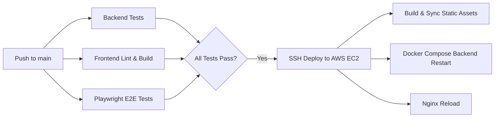

# Meet-Me 📹⚡

> A modern, lightweight, peer-to-peer video conferencing and real-time collaboration platform built from scratch with **WebRTC (Full Mesh Topology)** and **WebSocket Signaling**.

[](https://github.com/BekmurodGofurov/meet-me/actions/workflows/ci.yml)
[](https://meet-me.bekmurod.uz)
[](https://nodejs.org/)
[](https://react.dev/)
[](https://vitejs.dev/)
[](https://webrtc.org/)
[](https://playwright.dev/)
[](https://www.docker.com/)
[](https://opensource.org/licenses/ISC)

---

## 🌟 Overview

**Meet-Me** is an open-source, multi-party video conferencing application designed to demonstrate the fundamentals of **WebSocket signaling** and **WebRTC peer-to-peer connections** without relying on third-party media servers (SFU/MCU).

### 🎯 Key Engineering Goals

- **Strict Layer Separation:** The signaling server solely orchestrates discovery and exchanges lightweight JSON control messages (offers, answers, ICE candidates, and chat). **Zero media bytes (audio/video) ever pass through the server.**
- **Pure Mesh Topology:** Every peer establishes direct, bi-directional `RTCPeerConnection`s with every other peer in the room (optimal for 2–6 participants).
- **Production-Ready Resilience:** Implements the **"Perfect Negotiation"** pattern to deterministically eliminate offer/answer collisions (glare), automated session recovery on page refresh, and fallback TURN relay servers for NAT/firewall traversal.

---

## ✨ Features

- 🎥 **Multi-Party Video & Audio:** Peer-to-peer mesh conferencing supporting up to 6 participants with ultra-low latency.
- 🖥️ **Screen Sharing with Dual Streams:** Independent screen sharing stream alongside live camera feed using dual WebRTC transceivers.
- 📌 **Dynamic Grid & Video Pinning:** Automatic priority pinning for active screen shares with one-click manual pinning/unpinning of any participant.
- 💬 **Real-time In-Room Chat:** Fast WebSocket text messaging featuring:
  - Automatic URL link detection and safe rendering (`target="_blank"`, `rel="noopener noreferrer"`).
  - Join/leave system announcements and actionable status messages.
- 🔄 **Session Persistence & Graceful Reconnect:**
  - Auto-rejoin via `localStorage` when refreshing the browser.
  - Server-side **grace period timer (10s)** preserving empty rooms temporarily during quick client reloads.
- 🔒 **Security & Protocol Integrity:**
  - Configurable shared secret key authentication (`SECRET_KEY`) for WebSocket handshakes.
  - Server-side identity stamping (`senderId`) preventing client impersonation.
  - Input sanitization and name length capping (max 24 characters).
- 🌐 **NAT Traversal (STUN / TURN):** Out-of-the-box configuration with public Google STUN and Metered TURN relays for symmetric NATs and restrictive firewalls.
- 🩺 **Actionable Device Diagnostics:** Real-time diagnostics guiding users through browser permission errors (camera/mic blocked or unavailable).
- 🎨 **Responsive UI & Themes:** Clean SCSS architecture with dark and light themes, responsive video grids, and mobile-friendly layouts.

---

## 🏗️ Architecture & Topology

### 1. Signaling vs. Media Data Flow

```
                 ┌────────────────────────────────┐
                 │       WebSocket Server         │
                 │   (Node.js + ws, Port 8080)    │
                 └──────┬──────────┬──────────┬───┘
                        │          │          │
        SDP & ICE Relay │          │          │ SDP & ICE Relay
                        ▼          ▼          ▼
                 ┌──────────┐ ┌──────────┐ ┌──────────┐
                 │ Client A │ │ Client B │ │ Client C │
                 └────┬─────┘ └────┬─────┘ └────┬─────┘
                      │            │            │
                      │◄───────────┴───────────►│
                      │  Direct WebRTC Streams  │
                      │   (Audio / Video / Screen)
```

| Layer | Protocol | Role | Payload |
|---|---|---|---|
| **Signaling** | WebSocket (`ws://` / `wss://`) | Room management, presence, SDP exchange, ICE candidate relay, chat messages | Small JSON messages |
| **Media** | WebRTC (`RTCPeerConnection` over SRTP/UDP) | Direct peer-to-peer audio, video, and screen share delivery | Encrypted raw media frames |

### 2. Full Mesh Topology

In a 6-person room, each participant maintains direct peer connections with the other 5 participants ($N \times (N - 1) / 2 = 15$ total connections across the room).

```
         Client A <===============> Client B
            ▲   \                     /   ▲
            ║    \                   /    ║
            ║     ▼                 ▼     ║
            ║   Client E <=====> Client F  ║
            ║     ▲                 ▲     ║
            ║    /                   \    ║
            ▼   /                     \   ▼
         Client C <===============> Client D
```

---

## 📡 WebSocket Signaling Contract

Communication between client and signaling server follows a frozen protocol:

| Message Type | Direction | Purpose |
|---|---|---|
| `create-room` | Client ➔ Server | Requests generation of a new 6-character room code |
| `room-created` | Server ➔ Client | Confirms room creation with `roomId` and assigned `clientId` |
| `join-room` | Client ➔ Server | Joins an existing room using a 6-character code |
| `existing-peers`| Server ➔ Client | Returns the list of currently connected peers in the room |
| `peer-joined` | Server ➔ Peers | Notifies existing peers that a new participant has arrived |
| `offer` | Client ➔ Peer (via Server) | Sends an SDP offer to establish a WebRTC connection |
| `answer` | Client ➔ Peer (via Server) | Returns an SDP answer confirming media capabilities |
| `ice-candidate`| Client ➔ Peer (via Server) | Exchanges network connectivity candidates |
| `media-state` | Client ➔ Peers (via Server) | Broadcasts camera, microphone, or screen sharing state changes |
| `chat-message` | Client ➔ Peers (via Server) | Broadcasts in-room text chat |
| `leave-room` | Client ➔ Server | Explicitly exits the room and releases resources |
| `peer-left` | Server ➔ Peers | Notifies remaining peers to close their respective peer connections |
| `error` | Server ➔ Client | Dispatches error notifications (e.g., room full, invalid code) |

*For complete message schemas and payload examples, refer to [docs/contract.md](docs/contract.md).*

---

## 🗂️ Project Structure

```text
meet-me/
├── backend/                  # Signaling service
│   ├── server.js             # HTTP/HTTPS entry point & health check
│   ├── signaling.js          # Core WebSocket signaling logic & room state
│   ├── signaling.test.js     # Native Node.js test suite
│   ├── Dockerfile            # Production Node.js container build
│   └── package.json
├── client/                   # Frontend SPA
│   ├── src/
│   │   ├── components/       # UI components (Room, Lobby, Chat, VideoTile, etc.)
│   │   ├── hooks/            # Custom hooks (useRoom, useLocalMedia)
│   │   ├── App.jsx           # Main application state coordinator
│   │   └── session.js        # Session storage helpers for rejoining
│   ├── vite.config.js        # Vite build & reverse-proxy configuration
│   ├── vitest.config.js      # Unit test configuration
│   └── package.json
├── e2e/                      # End-to-end integration test suite
│   ├── tests/                # Playwright tests with fake media devices
│   └── playwright.config.js  # Playwright runner configuration
├── deploy/                   # Production server configuration
│   └── meet-me.conf          # Nginx reverse proxy & WebSocket configuration
├── docs/                     # Architectural documentation & specifications
│   ├── contract.md           # Frozen WebSocket signaling schema
│   └── video-room-app-requirements.md
├── .github/workflows/        # Automated CI/CD pipeline
│   └── ci.yml                # Lint, unit tests, E2E tests & EC2 deployment
├── docker-compose.yml        # Docker service orchestration
└── .env.example              # Environment variables template
```

---

## 🛠️ Tech Stack

### Frontend
- **Framework:** [React 19](https://react.dev/)
- **Bundler / Dev Server:** [Vite 8](https://vitejs.dev/)
- **Styles:** Modular [Sass (SCSS)](https://sass-lang.com/) with CSS variables
- **Testing:** [Vitest](https://vitest.dev/) + [@testing-library/react](https://testing-library.com/)

### Backend
- **Runtime:** [Node.js](https://nodejs.org/) (>= 22.0.0, tested on Node 24)
- **WebSockets:** [`ws`](https://github.com/websockets/ws)
- **Testing:** Native `node:test` runner

### E2E & Automation
- **E2E Testing:** [Playwright](https://playwright.dev/) with automated Chromium fake media devices (`--use-fake-device-for-media-stream`)
- **CI / CD:** GitHub Actions

### Infrastructure & Deployment
- **Containerization:** Docker & Docker Compose
- **Web Server & Reverse Proxy:** Nginx with SSL (Let's Encrypt)
- **Cloud Provider:** AWS EC2

---

## ⚙️ Environment Configuration

Copy `.env.example` to `.env` in the root directory:

```bash
cp .env.example .env
```

| Variable | Default | Description |
|---|---|---|
| `PORT` | `8080` | Internal port that the backend process listens on |
| `BACKEND_PORT` | `8090` | Host port mapped by Docker Compose (`127.0.0.1:8090:8080`) |
| `SECRET_KEY` | `meet-me-secret-key-change-in-production` | Secret key required for WebSocket authorization |
| `ROOM_GRACE_MS` | `10000` | Room retention grace period in milliseconds when all peers leave |
| `VITE_WS_URL` | `/ws` | WebSocket URL for client (proxied by Vite in dev / Nginx in prod) |
| `VITE_API_URL` | `http://localhost:8080` | Backend HTTP API base URL |
| `VITE_SECRET_KEY` | `meet-me-secret-key-change-in-production` | Secret key passed by client in connection query string |

---

## 🚀 Getting Started

### Prerequisites

- **Node.js** >= 22.0.0 (Node 24 recommended)
- **npm** >= 10.0.0
- **Docker & Docker Compose** *(optional, for containerized run)*

### 1. Installation

Clone the repository and install dependencies for all workspaces:

```bash
git clone https://github.com/BekmurodGofurov/meet-me.git
cd meet-me

# Install backend dependencies
cd backend && npm install && cd ..

# Install frontend dependencies
cd client && npm install && cd ..

# Install e2e dependencies
cd e2e && npm install && cd ..
```

### 2. Running in Development Mode

You can run backend and frontend concurrently in two terminal tabs:

**Terminal 1 — Backend:**
```bash
cd backend
node server.js
# Or with npm test to verify
```
*Backend runs on `ws://localhost:8080`.*

**Terminal 2 — Frontend:**
```bash
cd client
npm run dev
```
*Frontend runs on `http://localhost:5173` with automated proxying of `/ws` to port 8080.*

Open `http://localhost:5173` in two separate browser windows (or Incognito mode) to test room creation, media streaming, screen sharing, and real-time chat!

> **Note on Mobile & LAN Devices:** Modern browsers restrict `navigator.mediaDevices.getUserMedia` to **Secure Contexts** (`localhost` or `https://`). For local network testing across smartphones or other PCs, generate local SSL certificates using [`mkcert`](https://github.com/FiloSottile/mkcert) inside `client/certs/`. The dev server and backend automatically detect and enable HTTPS/WSS when certificates are present.

---

## 🐳 Docker Deployment

Run the signaling service using Docker Compose:

```bash
docker compose up -d --build
```

Check container status and logs:

```bash
docker compose ps
docker compose logs -f backend
```

---

## 🧪 Testing Suite

Meet-Me maintains comprehensive test coverage across unit, integration, and end-to-end layers.

```bash
# 1. Run backend unit & integration tests (Node.js test runner)
npm --prefix backend test

# 2. Run frontend unit & component tests (Vitest)
npm --prefix client test

# 3. Run frontend ESLint code quality checks
npm --prefix client run lint

# 4. Run end-to-end multi-user video call tests (Playwright)
npm --prefix e2e test
```

### End-to-End Test Highlights
The Playwright suite verifies real browser WebRTC interactions by launching headless Chromium instances with fake media devices:
- `solo-room.spec.js`: Room creation, code input formatting, and local preview playback.
- `two-participants.spec.js`: Multi-tab join handshake, peer tile rendering, and real-time text chat exchange.
- `video-call.spec.js`: WebRTC media track transmission, audio/video toggle states, and screen sharing.
- `rejoin.spec.js`: Automatic session recovery and grace period retention on tab reload.

---

## 🚢 CI/CD & Production Architecture

The project features a fully automated continuous integration and continuous deployment pipeline powered by **GitHub Actions** (`.github/workflows/ci.yml`):



### Production Nginx Setup (`deploy/meet-me.conf`)

- Serves pre-built Vite static assets directly from `/var/www/meet-me-frontend` with client-side routing fallback.
- Proxies `/ws` signaling traffic to the containerized Node.js service running on `127.0.0.1:8090` with WebSocket upgrade headers and persistent timeouts (`3600s`).
- Free SSL termination managed seamlessly via Certbot / Let's Encrypt.

---

## 🤝 Contributing

Contributions, issues, and feature requests are welcome! Feel free to check the [issues page](https://github.com/BekmurodGofurov/meet-me/issues).

1. Fork the Project
2. Create your Feature Branch (`git checkout -b feature/AmazingFeature`)
3. Commit your Changes (`git commit -m 'feat: add some AmazingFeature'`)
4. Push to the Branch (`git push origin feature/AmazingFeature`)
5. Open a Pull Request

---

## 📄 License

This project is licensed under the [ISC License](LICENSE).

---

## 👤 Author

**Bekmurod Gofurov**
- GitHub: [@BekmurodGofurov](https://github.com/BekmurodGofurov)
- Website: [meet-me.bekmurod.uz](https://meet-me.bekmurod.uz)
