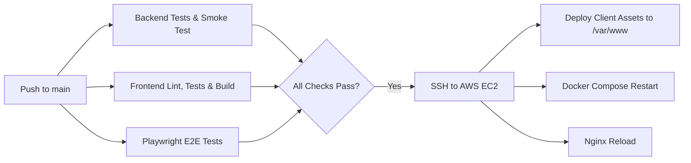

<p align="center">
  <a href="https://meet-me.bekmurod.uz" target="_blank" rel="noopener noreferrer">
    
  </a>
</p>

<h1 align="center">
  Meet-Me
</h1>

<h4 align="center">
  <a href="https://meet-me.bekmurod.uz">Live Demo</a> &nbsp;|&nbsp;
  <a href="#-getting-started">Getting Started</a> &nbsp;|&nbsp;
  <a href="#-features">Features</a> &nbsp;|&nbsp;
  <a href="#-architecture--topology">Architecture</a> &nbsp;|&nbsp;
  <a href="#-signaling-protocol-contract">Signaling Contract</a> &nbsp;|&nbsp;
  <a href="#-testing-suite">Tests</a>
</h4>

<p align="center">
  A modern, high-performance, peer-to-peer video conferencing and real-time collaboration engine built with <b>WebRTC (Full Mesh Topology)</b> and <b>WebSocket Signaling</b>.
</p>

<p align="center">
  <a href="https://github.com/BekmurodGofurov/meet-me/actions/workflows/ci.yml">
    
  </a>
  <a href="https://meet-me.bekmurod.uz">
    
  </a>
  <a href="https://nodejs.org/">
    
  </a>
  <a href="https://react.dev/">
    
  </a>
  <a href="https://vitejs.dev/">
    
  </a>
  <a href="https://webrtc.org/">
    
  </a>
  <a href="https://playwright.dev/">
    
  </a>
  <a href="https://opensource.org/licenses/ISC">
    
  </a>
  <a href="https://github.com/BekmurodGofurov/meet-me/pulls">
    
  </a>
</p>

---

## ⚡ Getting Started

The fastest way to experience Meet-Me is directly in your browser:

👉 **[Try Live Demo on meet-me.bekmurod.uz](https://meet-me.bekmurod.uz)**

To run the application locally on your machine in under two minutes:

```bash
# 1. Clone repository
git clone https://github.com/BekmurodGofurov/meet-me.git
cd meet-me

# 2. Setup environment variables
cp .env.example .env

# 3. Install dependencies
npm --prefix backend install
npm --prefix client install

# 4. Start backend signaling service (Terminal 1)
npm --prefix backend start

# 5. Start frontend client (Terminal 2)
npm --prefix client run dev
```

Visit [`http://localhost:5173`](http://localhost:5173) in two browser tabs or devices, create a room, share the 6-character code, and start conferencing!

---

## 📖 About Meet-Me

**Meet-Me** is an open-source, multi-party video conferencing system engineered to demonstrate the real-world mechanics of **WebSocket-based signaling** and direct **WebRTC peer-to-peer connections**.

Instead of relying on heavy media servers (like SFUs or MCUs) or commercial black-box SDKs, Meet-Me implements a pure, decentralized full-mesh architecture:

- **Signaling Layer:** A lightweight, single-process Node.js WebSocket service responsible solely for room discovery, presence management, and forwarding SDP offers, answers, and ICE candidates.
- **Media Layer:** Direct browser-to-browser encrypted audio, video, and screen sharing feeds over SRTP/UDP. **Media bytes never touch the server.**
- **Mesh Topology:** Tailored specifically for small-group collaboration (2–6 participants), balancing resource efficiency with near-zero latency.

---

## ✨ Features

- 🎥 **Multi-Party HD Audio & Video:** True peer-to-peer mesh conferencing supporting up to 6 participants with ultra-low latency.
- 🖥️ **Screen Sharing with Dual-Stream Support:** Share your screen while keeping your camera active using dual WebRTC transceivers.
- 📌 **Smart Video Grid & Stream Pinning:** Automatic priority pinning for active screen shares with one-click manual focus pinning on any participant tile.
- 💬 **In-Room Real-Time Chat:**
  - Fast WebSocket messaging with low overhead.
  - Automatic URL regex detection with sanitized, safe links (`target="_blank"`, `rel="noopener noreferrer"`).
  - System event announcements (user joined, user left).
- 🔄 **Session Persistence & Resilient Reconnection:**
  - Tab refresh auto-reconnect via `localStorage` session state.
  - Server-side **10-second grace period** preventing empty room cleanup during client reloads.
- 🔒 **Security & Identity Integrity:**
  - WebSocket authorization via shared secret key (`SECRET_KEY`).
  - Server-enforced identity stamping (`senderId`) preventing client impersonation.
  - Automatic name truncation and input sanitization (max 24 characters).
- 🌐 **Comprehensive NAT Traversal (STUN / TURN):** Integrated with Google STUN and Metered TURN relays for symmetric NAT and corporate firewall traversal.
- 🩺 **Actionable Device Diagnostics:** Informative UI banners when camera or microphone permissions are blocked or hardware is busy.
- 🎨 **Polished Modern UI:** Responsive Sass/SCSS architecture featuring dark and light theme support across mobile, tablet, and desktop viewports.

---

## 🏛️ Architecture & Topology

### 1. Separation of Concerns: Signaling vs. Media

```
                         ┌────────────────────────┐
                         │   Signaling Service    │
                         │   (Node.js + ws:8080)  │
                         └───────────┬────────────┘
                                     │
                 ┌───────────────────┼───────────────────┐
                 │ (SDP / ICE JSON)  │ (SDP / ICE JSON)  │ (SDP / ICE JSON)
                 ▼                   ▼                   ▼
           ┌───────────┐       ┌───────────┐       ┌───────────┐
           │ Browser A │◄═════►│ Browser B │◄═════►│ Browser C │
           └───────────┘       └───────────┘       └───────────┘
                 ▲                                       ▲
                 ╚═══════════════════════════════════════╝
                      Direct P2P Encrypted Media
```

| Layer | Protocol | Responsibilities | Data Handled |
|---|---|---|---|
| **Signaling Layer** | WebSocket (`ws://` / `wss://`) | Room lifecycle, presence, SDP exchange, ICE relay, text chat | Lightweight JSON control messages |
| **Media Layer** | WebRTC (`RTCPeerConnection`) | Audio tracks, video tracks, screen sharing tracks | Direct SRTP/UDP peer streams |

### 2. Full Mesh Network (Up to 6 Peers)

In a 6-participant room, every browser opens an independent peer connection to every other browser in the room ($N \times (N - 1) / 2 = 15$ total connections):

```
               Client A <=====================> Client B
                  ▲   \                             /   ▲
                  ║    \                           /    ║
                  ║     ▼                         ▼     ║
                  ║   Client E <=============> Client F  ║
                  ║     ▲                         ▲     ║
                  ║    /                           \    ║
                  ▼   /                             \   ▼
               Client C <=====================> Client D
```

### 3. "Perfect Negotiation" Pattern

To prevent negotiation collisions (glare) when both peers attempt to initiate an SDP renegotiation simultaneously (e.g. both toggling cameras at once), Meet-Me follows the W3C **Perfect Negotiation** specification:
- One peer is assigned the **polite** role (the joiner); the other is **impolite** (the host).
- Polite peers roll back local offers if a collision is detected; impolite peers ignore conflicting incoming offers until their own is answered.

---

## 📡 Signaling Protocol Contract

The communication contract between frontend clients and the signaling server is strictly typed and deterministic:

| Message Type | Direction | Payload Summary | Description |
|---|---|---|---|
| `create-room` | Client ➔ Server | `{ name: string }` | Requests a new room code |
| `room-created` | Server ➔ Client | `{ roomId, clientId, name }` | Confirms room creation |
| `join-room` | Client ➔ Server | `{ roomId, name }` | Joins an existing room |
| `existing-peers`| Server ➔ Client | `{ roomId, clientId, peers: [] }` | Roster of existing room participants |
| `peer-joined` | Server ➔ Peers | `{ clientId, name }` | Notifies room of a new joiner |
| `offer` | Client ➔ Peer (Relay) | `{ targetId, sdp }` | WebRTC session offer |
| `answer` | Client ➔ Peer (Relay) | `{ targetId, sdp }` | WebRTC session answer |
| `ice-candidate`| Client ➔ Peer (Relay) | `{ targetId, candidate }` | ICE network candidate |
| `media-state` | Client ➔ Peers | `{ cameraOn, micOn, screenSharing }`| Broadcasts media status updates |
| `chat-message` | Client ➔ Peers | `{ text: string }` | In-room text broadcast |
| `leave-room` | Client ➔ Server | *(none)* | Explicit room exit |
| `peer-left` | Server ➔ Peers | `{ clientId }` | Notifies peers to clean up connections |
| `error` | Server ➔ Client | `{ message: string }` | Operational or validation error |

> 📖 *For complete message payload schemas and lifecycle behavior, see the [WebSocket Contract Specification](docs/contract.md).*

---

## 📂 Project Structure

```text
meet-me/
├── backend/                  # Node.js WebSocket signaling server
│   ├── server.js             # HTTP/HTTPS server bootstrap & health check
│   ├── signaling.js          # Core signaling logic, room Map, and grace periods
│   ├── signaling.test.js     # Native Node.js test runner suite (26 tests)
│   ├── Dockerfile            # Production Node.js alpine container build
│   └── package.json
├── client/                   # React 19 single-page application
│   ├── src/
│   │   ├── components/       # Room, Lobby, Chat, VideoTile, MediaControls
│   │   ├── hooks/            # useRoom (WebRTC orchestration), useLocalMedia
│   │   ├── App.jsx           # Root application coordinator
│   │   ├── session.js        # Session persistence and reconnect utilities
│   │   └── App.scss          # Themes, video grid layout, responsive styles
│   ├── vite.config.js        # Reverse proxy and mkcert HTTPS detection
│   ├── vitest.config.js      # Vitest runner configuration
│   └── package.json
├── e2e/                      # Playwright end-to-end multi-browser test suite
│   ├── tests/                # Video call, solo room, multi-participant, rejoin
│   └── playwright.config.js
├── deploy/                   # Production server configuration
│   └── meet-me.conf          # Nginx reverse proxy configuration with WSS upgrade
├── docs/                     # Architectural specifications and contracts
│   ├── contract.md           # Frozen signaling protocol schema
│   └── video-room-app-requirements.md
├── .github/workflows/
│   └── ci.yml                # Automated CI pipeline & EC2 CD deployment
├── docker-compose.yml        # Docker service definition
└── .env.example              # Environment variables template
```

---

## 🛠️ Tech Stack & Tools

- **Frontend:** [React 19](https://react.dev/), [Vite 8](https://vitejs.dev/), [Sass (SCSS)](https://sass-lang.com/), [Vitest](https://vitest.dev/), [@testing-library/react](https://testing-library.com/)
- **Backend:** [Node.js 22+](https://nodejs.org/), [`ws`](https://github.com/websockets/ws), Native `node:test` runner
- **WebRTC & Media:** WebRTC standard API, Google STUN (`stun.l.google.com:19302`), Metered TURN relay
- **E2E Testing:** [Playwright](https://playwright.dev/) with automated fake media stream devices
- **DevOps & Cloud:** Docker, Docker Compose, Nginx Reverse Proxy, AWS EC2, GitHub Actions CI/CD

---

## ⚙️ Configuration

Environment variables can be customized in a `.env` file at the root:

```ini
# Backend configuration
PORT=8080
BACKEND_PORT=8090
SECRET_KEY=meet-me-secret-key-change-in-production
ROOM_GRACE_MS=10000

# Client configuration (Vite)
VITE_WS_URL=/ws
VITE_API_URL=http://localhost:8080
VITE_SECRET_KEY=meet-me-secret-key-change-in-production
```

---

## 💻 Local Development & HTTPS

### Running with Local SSL (Optional, for Mobile / LAN testing)

Browsers require a **Secure Context** (`localhost` or `https://`) to access `navigator.mediaDevices.getUserMedia()`. If testing from a smartphone or external computer on your local WiFi:

1. Install [`mkcert`](https://github.com/FiloSottile/mkcert):
   ```bash
   brew install mkcert
   mkcert -install
   ```
2. Generate certificates for your local IP inside `client/certs/`:
   ```bash
   mkdir -p client/certs
   cd client/certs
   mkcert localhost 127.0.0.1 <YOUR_LAN_IP>
   cd ../..
   ```
3. Start the dev servers normally. Vite and the backend server automatically detect the certificates and serve over `https://` and `wss://`.

---

## 🐳 Docker Deployment

To build and run the signaling server inside an isolated container:

```bash
# Start container in detached mode
docker compose up -d --build

# View container logs
docker compose logs -f backend

# Stop container
docker compose down
```

---

## 🧪 Testing Suite

Meet-Me includes rigorous automated tests covering backend signaling, frontend components, and multi-browser WebRTC interactions:

```bash
# Backend unit & integration tests (26 passing tests)
npm --prefix backend test

# Frontend unit & component tests (89 passing tests)
npm --prefix client test

# Frontend ESLint code quality checks
npm --prefix client run lint

# Playwright End-to-End integration tests
npm --prefix e2e test
```

### End-to-End Test Highlights
The Playwright suite verifies real browser interactions using Chromium with fake media flags:
- `solo-room.spec.js`: Room creation, room code formatting, and local video playback.
- `two-participants.spec.js`: Multi-tab negotiation, reciprocal video streams, and real-time chat.
- `video-call.spec.js`: Camera/microphone mute toggle reflection and screen share tracks.
- `rejoin.spec.js`: Session persistence across tab reloads without breaking room membership.

---

## 🚀 Production Deployment & CI/CD

Every push to the `main` branch triggers an automated GitHub Actions pipeline (`.github/workflows/ci.yml`):



### Nginx Reverse Proxy (`deploy/meet-me.conf`)
The production instance runs behind Nginx:
- Static client assets are served directly from `/var/www/meet-me-frontend` with HTML5 pushState fallback.
- The `/ws` path proxies WebSocket signaling to `127.0.0.1:8090` with persistent `3600s` connection timeouts and upgrade headers.
- SSL certificates are provisioned and renewed automatically via Let's Encrypt / Certbot.

---

## 🤝 Contributing

Contributions, feature requests, and bug reports are welcome!

1. Fork the Project
2. Create your Feature Branch (`git checkout -b feature/AmazingFeature`)
3. Commit your Changes (`git commit -m 'feat: add some AmazingFeature'`)
4. Push to the Branch (`git push origin feature/AmazingFeature`)
5. Open a Pull Request

---

## 📄 License

This project is licensed under the [ISC License](LICENSE).

---

## 👤 Author

**Bekmurod Gofurov**
- GitHub: [@BekmurodGofurov](https://github.com/BekmurodGofurov)
- Live Platform: [meet-me.bekmurod.uz](https://meet-me.bekmurod.uz)
